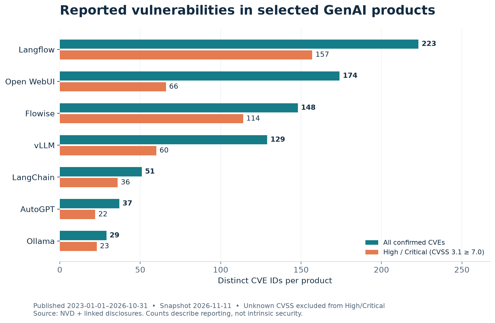

# RQ5 · Reported vulnerabilities in selected Generative AI products

**Group 4 — زبان تخصصی**  
**ایلیا هراتی** · معین رحیمی · فاطمه نظری · ریحانه شیری · پوریا اسلامی

Which selected Generative AI products have the most reported CVEs, and the most High/Critical CVEs?

Publication window: **1 January 2023–31 October 2026**. Evidence snapshot: **11 November 2026**.

## Start here

1. Open **reports/RQ5_Report.html** in any browser for the designed research report.
2. Read **docs/PRESENTATION_FA.md** for a Persian explanation and presentation questions.
3. Open **notebooks/RQ5_Analysis.ipynb** for the executed analysis. Outputs are already saved.
4. Inspect **data/clean_cves.csv**, **data/product_summary.csv** and **data/validation_ledger.csv** for the evidence.

## Run it yourself

Use Python **3.12**. From this folder:

~~~bash
python -m venv .venv
# Windows PowerShell:
.venv\Scripts\Activate.ps1
# macOS/Linux: source .venv/bin/activate
python -m pip install -r requirements.txt
python scripts/reproduce.py
python -m pytest -q
python scripts/execute_notebook.py
~~~

The analysis and tests use the complete evidence archive in data/evidence.tar.xz. On first execution it automatically expands into the ignored data/.evidence_cache folder (about 208 MiB), using only the Python standard library. The compact repository and upload keep that cache out of Git. The analysis and tests use local snapshots: **no network, API key or secret is needed** after dependency installation. The last command executes every notebook cell and exports an HTML copy. Alternatively open the notebook in VS Code/Jupyter and choose Run All. Reproduction regenerates the unexecuted notebook first; execute it afterwards to save outputs.

## What makes the counts defensible?

- All seven core products in the assignment are included. Optional products are outside this fixed scope.
- NVD keyword discovery is cross-checked against supplementary CPE-family queries.
- Each counted association has scoped affected-product evidence and a retrieved linked disclosure.
- Third-party forks, unrelated matches and rejected CVEs are excluded. Langflow Desktop is excluded from the Langflow OSS scope.
- Every decision is recorded; unresolved evidence stays visible.
- One distinct product–CVE pair is counted once, regardless of versions, aliases or advisory count.
- CVSS **3.1 only**; NVD scores preferred, then Primary metrics, then deterministic source order. Missing values are not zero.
- The analysis includes severity missingness, NVD-only sensitivity and unresolved-evidence bounds.
- Input checksums and compressed advisory snapshots support independent inspection.

Read **reports/FINDINGS.md** for the generated answer and **docs/METHODS.md** for the full protocol. Larger counts describe reporting in this sample; they are not a ranking of intrinsic security.

## Files

| Path | Purpose |
|---|---|
| notebooks/RQ5_Analysis.ipynb | Executed research notebook |
| reports/RQ5_Report.html | Standalone designed report with embedded charts |
| reports/RQ5_Notebook.html | Notebook with outputs, readable without Jupyter |
| reports/figures/ | Three charts, PNG and editable SVG |
| reports/linkedin_post.md | 150–250-word English dissemination draft; not posted |
| data/clean_cves.csv | Confirmed observations and row-level evidence |
| data/validation_ledger.csv | Confirmed, unrelated, rejected and unresolved decisions |
| data/product_summary.csv | Counts, denominators, missingness and sensitivity |
| data/evidence.tar.xz | Complete NVD/CNA data and full disclosure bodies, compressed together |
| data/evidence_archive.sha256 | Archive integrity checksum |
| data/source_manifest.json | SHA-256 for every source inside the evidence archive |
| config.json | Product scope, identifiers, official repositories, dates |
| src/analysis.py | Attribution, scoring, deduplication and aggregation |
| scripts/reproduce.py | Offline build of results, charts, report and notebook |
| scripts/collect.py | Optional fresh discovery into a separate folder |
| tests/test_analysis.py | Rule and evidence-integrity tests |
| docs/PRESENTATION_FA.md | Persian explanation, speaking plan and Q&A |
| docs/DATA_DICTIONARY.md | Field definitions and missing-value policy |

## Submitting on GitHub

Upload this folder's contents to your repository, including data/evidence.tar.xz (needed for offline reproduction). The expanded data/.evidence_cache folder and any legacy data/raw folder are ignored automatically; do not copy them into the uploaded project. Do not upload the virtual environment. Keep README.md at the repository root. Check that the notebook and chart render on GitHub, then submit the repository link to the instructor. Nothing has been published automatically.

## Sources and attribution

- [NVD API 2.0](https://nvd.nist.gov/developers/vulnerabilities)
- [NVD API usage](https://nvd.nist.gov/developers/start-here)
- [CVE Program primary CNA records](https://github.com/CVEProject/cvelistV5)
- [FIRST CVSS 3.1 specification](https://www.first.org/cvss/v3.1/specification-document)
- Individual upstream, coordinated-disclosure and original-researcher advisories linked in the CSV.

This project used AI assistance for implementation, collection and analysis. The group should review the methods and findings before presenting. Group names identify the team; no unverified individual contribution claims are made. Source snapshots retain their original authors' rights; they are included as evidence with attribution, not relicensed.
